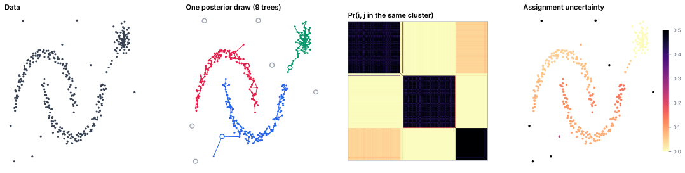
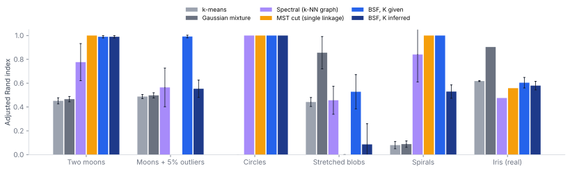
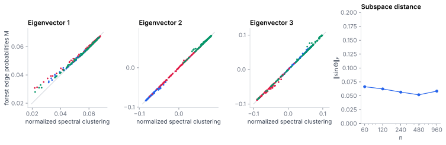
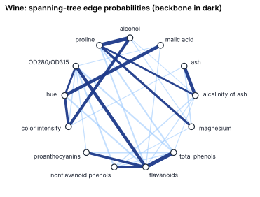

<h1 align="center">bayesian-geometric-forest</h1>

<p align="center"><b>Clusters as trees. Forests drawn exactly. Uncertainty you can see.</b></p>

<p align="center">
<a href="https://github.com/numberingeometry/bayesian-geometric-forest/actions/workflows/test.yml"></a>
<a href="https://numberingeometry.github.io/bayesian-geometric-forest/"></a>

<a href="LICENSE"></a>
</p>

<p align="center"></p>

`bgforest` implements the **Bayesian spanning forest** of Duan & Roy (*JASA* 2024): every
cluster is a tree grown from a root, the trees are summed out, and what remains is a
posterior over partitions, including the number of clusters. Because that posterior is a
weighted spanning-tree law on an augmented graph, a whole forest can be **drawn exactly**
with Wilson's algorithm, and edge probabilities have a **closed form**. Every identity the
code relies on is **checked against brute-force enumeration** in CI.

**[Interactive explorer](https://numberingeometry.github.io/bayesian-geometric-forest/explorer/)** ·
[Documentation](https://numberingeometry.github.io/bayesian-geometric-forest/) ·
[Model and math](docs/theory.md) · [Verification](docs/verification.md)

## Why it is interesting

- **No shape assumption inside a cluster.** A point only needs a nearby neighbour in the
  same tree, so moons, rings and spirals are natural, and isolated points become their own
  trees instead of distorting a cluster.
- **Exact forest draws.** Given the kernel, each forest is an exact sample from the
  posterior. With fixed scales the draws are independent, with no burn-in; with the paper's
  adaptive scales, the forest step of the Gibbs sampler is exact.
- **Closed forms.** $\Pr[(i,j) \in \text{forest} \mid y] = A_{ij} R_{\text{eff}}(i,j)$ and
  $\mathbb E[K \mid y] = \sum_i A_{0i} (L_g^{-1})_{ii}$, from one Cholesky factorisation.
- **A probabilistic reading of spectral clustering.** The leading eigenvectors of the
  edge-probability matrix match those of normalized spectral clustering (Duan & Roy,
  Theorem 1), shown numerically below.

## Quick start

```bash
python -m pip install "git+https://github.com/numberingeometry/bayesian-geometric-forest"
```

```python
from sklearn.datasets import make_moons
from bgforest import BayesianSpanningForest

X, y = make_moons(n_samples=300, noise=0.07, random_state=1)
model = BayesianSpanningForest(random_state=0).fit(X)   # K is inferred

model.n_clusters_posterior_      # {1: 0.05, 2: 0.42, 3: 0.37, 4: 0.12, 5: 0.03, 6: 0.01}
model.labels_                    # point estimate (ARI 1.0 here)
model.co_clustering_matrix_      # Pr(i and j share a cluster | data)
model.assignment_uncertainty()   # per-point uncertainty
model.forests_                   # every retained forest, as parent pointers
```

This takes about ten seconds ([`examples/01_quickstart.py`](examples/01_quickstart.py)).
Isolated points are trees of their own, which is why the posterior over $K$ has mass
above 2.

## One posterior, four views



Two moons, a blob joined to one moon by a thin bridge, and a few outliers. Outliers become
single-point trees; the bridge makes the blob and the lower moon share a cluster in a
minority of draws, which shows up as an off-diagonal block in the co-clustering matrix and
as raised uncertainty along the half of that moon nearest the bridge.

## How it compares



Six methods, six datasets, five seeds; every method except "K inferred" is told the true
number of clusters. Scores are adjusted Rand index against the generating labels; on
"Moons + 5% outliers" every point is clustered and only the moon points are scored.
Script: [`examples/03_benchmark.py`](examples/03_benchmark.py); numbers:
[`figs/benchmark.csv`](figs/benchmark.csv).

- **Shape-defined clusters** (moons, circles, spirals): BSF matches the best graph methods
  (ARI 0.99–1.00) where centroid methods fail.
- **Outliers**: cutting the minimum spanning tree spends its cuts on isolated points and
  collapses to **0.00**; spectral clustering drops to 0.57; BSF stays at **0.99**, because
  outliers become trees of their own. This is Duan & Roy's point that averaging over trees
  is more robust than committing to one.
- **Elliptical, overlapping clusters** (stretched blobs, Iris) are where a Gaussian mixture is
  the right model, and it wins (0.86 and 0.90 against BSF's 0.53 and 0.60). A forest
  clusters by connectivity: two touching clouds are one cluster to it.
- **Inferring K is the hard part.** The posterior mode of $K$ is right on moons and circles,
  but on the outlier, spiral and blob data it counts outlier trees or split arms, and that
  point estimate drops to 0.09–0.55. The full posterior over $K$ is returned rather than
  hidden behind one number.

## Spectral clustering, read probabilistically



On the three-component Gaussian mixture of Duan & Roy's Figure 2, the top three
eigenvectors of the closed-form edge-probability matrix $M$ and of the normalized
Laplacian agree up to a rotation, with subspace distance $\lVert\sin\Theta\rVert_F$ near
0.05 from $n = 60$ to $n = 960$ ([`examples/04_theorem1.py`](examples/04_theorem1.py)).

## Feature backbones



`SpanningTreeBackbone` gives the backbone tree of a feature dependence graph (for Gaussian
data, the Chow–Liu tree) and the exact probability that each pair is an edge of a random
spanning tree on a correlation kernel. It is a descriptive tool inspired by Duan & Dunson's
Bayesian spanning tree (*JMLR* 2023), not a reproduction of that model.

## Verified, not asserted

Every check below compares fast code with an independent brute-force answer: all
$N^{N-2}$ labelled trees of the augmented graph, or all set partitions. Exact identities
are held to $10^{-10}$; sampling checks are chi-square tests at $\alpha = 0.001$ with fixed
seeds. `python scripts/verify_exactness.py` reproduces the table, and CI runs it on every
push. The checks cover everything that holds for a given kernel; the adaptive-scale updates
are the paper's conjugate conditionals transcribed, and are not covered by them (inspect the
chain traces, or run several seeds).

<!-- verification:start -->
| Check | Method | Result | |
|---|---|---|---|
| Matrix-tree theorem | log tau via one determinant vs sum over all m^(m-2) trees, m = 2..7 | max abs error 0.0e+00 (log scale) | PASS |
| Partition posterior | closed form vs all 7^5 = 16,807 augmented trees, all 203 partitions of n = 6 | max abs error 1.4e-15 | PASS |
| Edge probabilities | A_ij R_eff(i, j) vs enumeration, incl. root edges | max abs error 4.2e-15 | PASS |
| Exact forest draws | 100,000 Wilson draws vs enumerated posterior over 62 partitions | chi-square p = 0.321, TV = 0.0042 | PASS |
| Constrained draws | 40,000 rejection draws vs enumerated conditional posterior (26 partitions) | chi-square p = 0.872, TV = 0.0033; acceptance 0.165 vs Pr(constraints) 0.166 | PASS |
| Duan & Roy Theorem 1 (illustration) | subspace distance (Frobenius sin-theta) between top-3 eigenvectors of M and of -N; 3-component mixture, sigma_ij = 1 | n = 60: 0.066; n = 120: 0.062; n = 240: 0.057; n = 480: 0.052; n = 960: 0.058 | shown |
<!-- verification:end -->

## Faithful to the paper, and where it is not

| | Duan & Roy (2024) | `bgforest` |
|---|---|---|
| Model and hyper-priors | Gaussian leaves with local scales, Cauchy root, $\Pi(\mathcal T) \propto \lambda^K$ | the same, with the paper's constants |
| Forest step | Aldous–Broder covering walk (exact) | Wilson's algorithm (exact, same law) |
| Point estimate | mode of $K$, then a rank-$K$ symmetric non-negative factorisation | mode of $K$ (or a given $K$), then top-$K$ eigenvectors and $k$-means |
| Fixed-kernel mode, closed forms | not discussed | independent exact draws, closed-form $M$ and $\mathbb E[K]$ |
| Must-link / cannot-link | not in the paper | exact conditioning by rejection (an extension) |
| Latent-forest, covariate, multi-view extensions | Sections 2.5 and 6 | not implemented |

Details, derivations and practical notes: [docs/theory.md](docs/theory.md).

## What else is in the box

| Component | What it does |
|---|---|
| `BayesianSpanningForest` | the clustering model above, scikit-learn style |
| `ConstrainedBayesianSpanningForest` | the same posterior conditioned on must-link / cannot-link pairs; `acceptance_rate_` estimates how plausible the constraints are |
| `ForestKernel` | augmented-graph weights, the marginal posterior of any partition, closed-form edge and root probabilities |
| `WilsonSampler` | exact weighted spanning trees, forests with given roots, and posterior forests |
| `SpanningTreeBackbone` | backbone tree and edge probabilities for features |
| `bgforest.exact` | brute-force enumeration of trees and partitions, the ground truth for the tests |

## Development

```bash
python -m pip install -e ".[dev]"
python -m pytest                       # unit tests, including exactness against enumeration
python scripts/verify_exactness.py     # the verification table
python examples/02_hero.py             # regenerate a figure (all figures are SVG)
```

`examples/` regenerates every figure and the explorer; the docs workflow only publishes
them, so the site never re-runs a long computation.

## References

- L. L. Duan and A. Roy. Spectral clustering, Bayesian spanning forest, and forest process.
  *Journal of the American Statistical Association* 119(547):2140–2153, 2024.
  [arXiv:2202.00493](https://arxiv.org/abs/2202.00493)
- Y. Zheng, L. L. Duan and A. Roy. Consistency of graphical model-based clustering: robust
  clustering using Bayesian spanning forest. Preprint,
  [arXiv:2409.19129](https://arxiv.org/abs/2409.19129)
- L. L. Duan and D. B. Dunson. Bayesian spanning tree: estimating the backbone of the
  dependence graph. *JMLR* 24(397):1–44, 2023. [arXiv:2106.16120](https://arxiv.org/abs/2106.16120)
- E. Tam, D. B. Dunson and L. L. Duan. Exact sampling of spanning trees via fast-forwarded
  random walks. *Biometrika* 112(2):asaf031, 2025. [arXiv:2405.03096](https://arxiv.org/abs/2405.03096)
- D. B. Wilson. Generating random spanning trees more quickly than the cover time. *STOC*, 1996.

## License

MIT; see [LICENSE](LICENSE).
