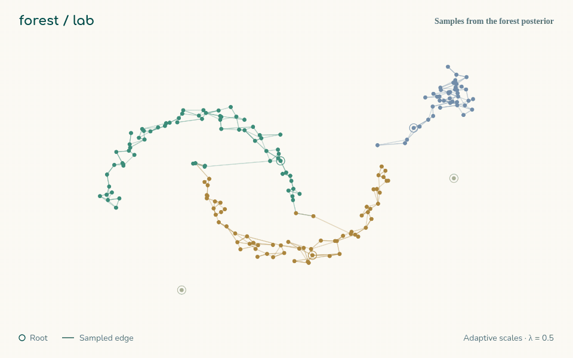

# Forest Lab

Explore the structure and uncertainty in a distribution of trees.

[](https://numberingeometry.github.io/bayesian-geometric-forest/explorer/)

Sample a forest. Inspect its connections. Compare established models on the same data.

**[Open the workbench](https://numberingeometry.github.io/bayesian-geometric-forest/explorer/)** ·
[Mathematics](docs/theory.md) · [Benchmarks](docs/benchmarks.md)

## Use the package

```sh
python -m pip install "git+https://github.com/numberingeometry/bayesian-geometric-forest"
```

`bgforest` implements the Bayesian spanning forest of Duan & Roy with Wilson sampling,
exact fixed-kernel identities and reproducible reference experiments.

[Quick start](https://numberingeometry.github.io/bayesian-geometric-forest/api/) ·
[Verification](docs/verification.md) · [MIT license](LICENSE)
