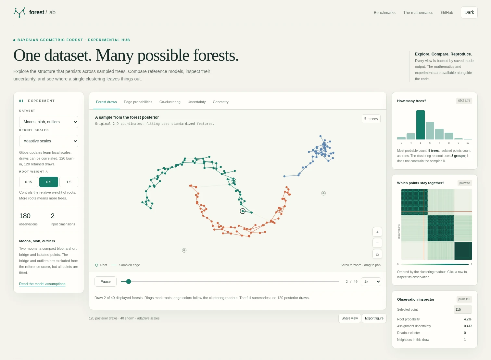
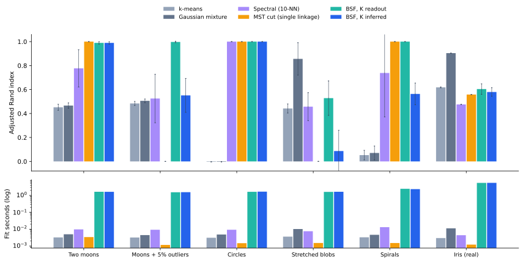

# Bayesian Geometric Forest

**A reproducible workbench for probabilistic trees, forest clustering, and graph geometry.**

[Open the workbench](https://numberingeometry.github.io/bayesian-geometric-forest/explorer/) · [Documentation](https://numberingeometry.github.io/bayesian-geometric-forest/) · [Benchmarks](docs/benchmarks.md) · [Mathematical reference](docs/theory.md)

[](https://github.com/numberingeometry/bayesian-geometric-forest/actions/workflows/test.yml)
[](pyproject.toml)
[](LICENSE)

[](https://numberingeometry.github.io/bayesian-geometric-forest/explorer/)

A single tree makes a structural decision. A distribution over trees lets us inspect how
stable that decision is. `bgforest` brings together a working Bayesian forest model,
exact sampling for fixed graph laws, matrix-tree identities, and experiments that show
both successes and failures.

The statistical reference is the **Bayesian spanning forest of Duan & Roy (JASA 2024)**:
Gaussian leaf densities with local scales, Cauchy root densities, and a weight per component.
Wilson's algorithm replaces the paper's cover-walk sampler while retaining the same
conditional forest law. This is a research and reproduction platform; the cited models,
algorithms, and identities are credited to their sources.

## Explore an actual experiment

The [interactive workbench](https://numberingeometry.github.io/bayesian-geometric-forest/explorer/)
links sampled forests, co-clustering, assignment disagreement, edge probabilities, root
probabilities, and Euclidean graph geometry. Three reproducible datasets include curved
synthetic clusters and the public four-feature Iris dataset.

- Switch between fixed local scales and adaptive-scale Gibbs inference.
- Compare three precomputed values of the component weight $\lambda$.
- Select a point to inspect its pairwise co-clustering probabilities and the full pair matrix.
- Compare a forest with a 10-nearest-neighbour graph, Euclidean MST, and spectral coordinates.
- Inspect the separate five-seed, six-case benchmark, timings, and run provenance.

Every model control selects a real precomputed fit. The browser performs no inference.
All probability summaries use all retained inference draws; the animation keeps a smaller,
explicitly counted subset. The page and its [data bundle](docs/explorer/data.json) are
self-contained and can be opened locally.

## Quick start

```bash
python -m pip install "git+https://github.com/numberingeometry/bayesian-geometric-forest"
```

```python
from sklearn.datasets import make_moons
from bgforest import BayesianSpanningForest

X, _ = make_moons(n_samples=200, noise=0.07, random_state=1)
model = BayesianSpanningForest(random_state=0).fit(X)

model.labels_                    # a point estimate
model.n_clusters_posterior_      # Monte Carlo distribution of the number of trees
model.co_clustering_matrix_      # estimated probability of sharing a component
model.assignment_uncertainty()   # disagreement with the point-estimate cluster
model.forests_                   # parent pointers; -1 marks a root
```

For independent draws with fixed scales, use `scales="local"`. In that mode,
`model.kernel_.root_count_distribution()` also gives the exact distribution of $K$.
Passing `n_clusters=2` sets the **final readout** to two clusters; it does **not** condition
the posterior on $K=2$.

## What is implemented

| Component | Target or purpose | Status |
|---|---|---|
| `BayesianSpanningForest` | Duan–Roy Gaussian/Cauchy forest clustering | Implemented; alternative spectral + k-means point estimate |
| `ForestKernel` | Arbitrary symmetric leaf weights and positive root weights | Exact partition weights, edge/root marginals, root attribution, and $K$ distribution |
| `WilsonSampler` | Weighted spanning trees and rooted forests | Exact independent draws for each fixed kernel |
| `ConstrainedBayesianSpanningForest` | Must-link / cannot-link conditioned forest | Exact fixed-kernel rejection sampler; can have low acceptance |
| `SpanningTreeBackbone` | Correlation-weighted feature tree | Descriptive tool; not the full Duan–Dunson Bayesian model |
| Reference benchmarks | Six clustering methods; Wilson vs weighted Aldous–Broder | Seeded datasets, scores, time, exact marginal errors, raw records |
| Latent geometry, tensor-tree and AI applications | Separate future research tracks | Not implemented; [questions and evaluation gates](docs/research.md) |

## The mathematical contract

For symmetric nonnegative leaf weights $w_{ij}$ and positive root weights $a_i$, write
$L$ for the leaf graph Laplacian, $Q=\operatorname{diag}(a)$, and $G=(L+Q)^{-1}$.
A rooted forest with one selected root per component has probability

$$
\Pr(F,R)=\frac{\prod_{e\in F}w_e\prod_{r\in R}a_r}{\det(L+Q)}.
$$

Edge and root probabilities are $w_{ij}(G_{ii}+G_{jj}-2G_{ij})$ and $a_iG_{ii}$.
The root-attribution matrix $GQ$ answers “which node roots this node's tree?”;
it is **not** the co-clustering matrix. For constant $a_i=q$, summing over root choices
introduces a factor $\prod_{C\in F}|C|$. This rooted law differs from an unrooted forest
weighted only by $q^K\prod_e w_e$.

In the Duan–Roy model, $a_i=\lambda r(y_i)$ varies with the observations. The general
constant-$q$ graph benchmarks are a separate reference family. See the
[derivations and model boundaries](docs/theory.md).

**Exactness has a scope.** Fixed-kernel Wilson draws are independent and exact. With
adaptive scales, each forest update is exact conditional on the scales; the joint Gibbs
chain is correlated and needs diagnostics. A determinant evaluated at posterior mean
scales does not equal a joint-posterior marginal.

## Benchmarks you can rerun



The benchmark compares k-means, Gaussian mixtures, 10-NN spectral clustering, single-linkage
MST cuts, and BSF with supplied or inferred $K$ readout. It reports ARI, adjusted mutual
information, per-run fit time, and BSF pairwise Brier scores. A separate experiment compares
Wilson and weighted Aldous–Broder on identical fixed graph laws, with exact edge/root
marginal errors and small-graph partition total variation.

These are transductive clustering experiments, not held-out prediction. Every method sees
the same standardized features. Supplied-$K$ and inferred-$K$ results remain separately
labelled. Negative reference labels are excluded from scoring while those observations
remain in fitting. Baseline settings are fixed rather than tuned to the labels. Raw JSON
and CSV include every requested seed, warnings, failures, environment, and timings.

```bash
python -m pip install -e ".[dev,docs]"
python scripts/run_benchmarks.py --profile standard  # 5 seeds; n=300 synthetic cases
python scripts/run_benchmarks.py --profile quick     # development / smoke comparison
python examples/07_explorer.py                     # rebuild all 18 workbench fits
```

[Protocol and measured results](docs/benchmarks.md) · [clustering JSON](docs/results/clustering.json) ·
[sampling JSON](docs/results/sampling.json). Shape clusters can favor graph methods;
elliptical overlap can favor mixtures. Unknown $K$, outliers, and root-weight sensitivity
are visible failure cases rather than exceptions removed from the report.

## Verification and development

```bash
python -m ruff check bgforest tests scripts examples
python -m pytest
python scripts/verify_exactness.py
mkdocs build --strict
```

Small-graph checks independently enumerate augmented labelled trees and set partitions.
They test partition weights, edge/root marginals, exact $K$ distributions, and sampling
frequencies. They establish fixed-kernel correctness on the tested cases, not general
Gibbs convergence or statistical calibration on arbitrary data. See [verification](docs/verification.md).

The dense kernel uses quadratic storage; factorizations and spectral readouts have cubic
cost. Tiny root weights can produce long random walks. Sparse graph models, new geometry
models, and quantum tensor-tree ensembles need their own explicit targets and validation.

## References

- L. L. Duan and A. Roy. *Spectral clustering, Bayesian spanning forest, and forest process.* JASA 119(547):2140–2153, 2024. [Paper](https://arxiv.org/abs/2202.00493).
- Y. Zheng, L. L. Duan and A. Roy. *Consistency of graphical model-based clustering: robust clustering using Bayesian spanning forest.* [Preprint](https://arxiv.org/abs/2409.19129).
- L. L. Duan and D. B. Dunson. *Bayesian spanning tree: estimating the backbone of the dependence graph.* JMLR 24(397):1–44, 2023. [Paper](https://jmlr.org/papers/v24/22-0252.html).
- D. B. Wilson. *Generating random spanning trees more quickly than the cover time.* STOC, 1996. [DOI](https://doi.org/10.1145/237814.237880).
- D. J. Aldous. *The random walk construction of uniform spanning trees and uniform labelled trees.* SIAM J. Discrete Math. 3(4):450–465, 1990. [DOI](https://doi.org/10.1137/0403039).
- A. Z. Broder. *Generating random spanning trees.* FOCS, 1989. [DOI](https://doi.org/10.1109/SFCS.1989.63516).
- P. Chebotarev and E. Shamis. *The matrix-forest theorem and measuring relations in small social groups.* Automation and Remote Control 58(9):1505–1514, 1997. [Preprint](https://arxiv.org/abs/math/0602070).
- L. Avena and A. Gaudillière. *Random spanning forests, Markov matrix spectra and well distributed points.* [Paper](https://arxiv.org/abs/1310.1723).
- E. Tam, D. B. Dunson and L. L. Duan. *Exact sampling of spanning trees via fast-forwarded random walks.* Biometrika 112(2):asaf031, 2025. [Paper](https://arxiv.org/abs/2405.03096). This sampler is not implemented here.

MIT; see [LICENSE](LICENSE).
