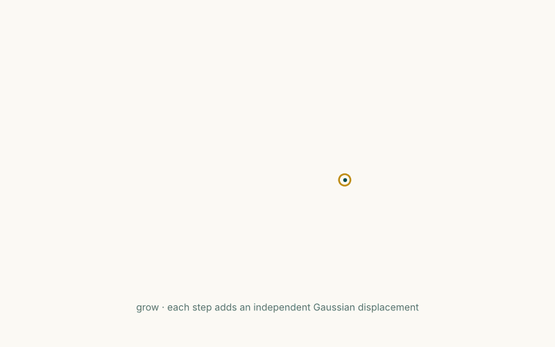

---
hide:
  - navigation
  - toc
---

TREES · PROBABILITY · GEOMETRY

# Which tree grew this cloud?

Turn one dial from random trees to single linkage.

[Turn the dial](dial/index.html){ .md-button .md-button--primary } [Explore forests](explorer/index.html){ .md-button }

<a href="dial/index.html" aria-label="Open the temperature dial"><picture><source media="(prefers-reduced-motion: reduce)" srcset="assets/grow-still.webp"></picture></a>

[The temperature dial](temperature.md) — the generative model, its two ends, and why single linkage appears.

[Forests of clusters](theory.md) — the Bayesian spanning forest of Duan & Roy.

[Use the code](api.md) — a small Python library, verified against enumeration.

Known mathematics, implemented exactly and checked on every push. <a href="verification/">Verification</a> · <a href="benchmarks/">Benchmarks</a>

