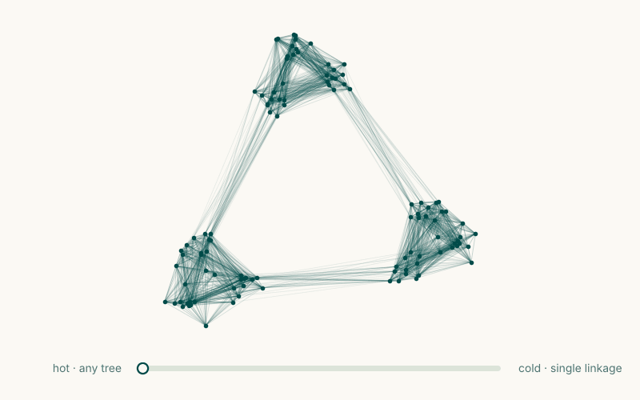

# One dial: from random trees to single linkage

**[Turn the dial](https://numberingeometry.github.io/bayesian-geometric-forest/dial/)**



A point cloud, one temperature, and a law over the trees that could have grown it.
Hot, every spanning tree is about equally likely. Cold, only the minimum spanning tree
survives, and its cuts are single-linkage clusters. This page states what the dial
computes. Everything here is known mathematics, or a short consequence of it, implemented
and checked against brute-force enumeration on the [verification page](verification.md).

Tags: **[known]** cites the source; **[elementary]** means the short argument is given
here, and none of it is claimed as new.

## The generative model

Grow a cloud by diffusion along a tree $T$ on $n$ nodes: put the root anywhere, and let
every step from a parent to a child add an independent $N(0, \sigma^2 I_d)$
displacement. The likelihood of the points is

$$
p(x \mid T) = (2\pi\sigma^2)^{-d(n-1)/2} \exp\Big(-\lambda S_T\Big),
\qquad S_T = \sum_{(i,j) \in T} \lVert x_i - x_j \rVert^2,
\qquad \lambda = \frac{1}{2\sigma^2}.
$$

It does not depend on which node is the root. Under a flat prior over trees, the
posterior is the **tree law**

$$
\Pi_\lambda(T) = \frac{e^{-\lambda S_T}}{Z(\lambda)}, \qquad Z(\lambda) = \sum_{T} e^{-\lambda S_T}.
$$

**[known]** This is Felsenstein's Brownian-motion model of a trait on a tree (see
Sturmfels, Uhler & Zwiernik, 2020), read as a law over trees. With roots attached to an auxiliary node,
it becomes the [Bayesian spanning forest](theory.md) of Duan & Roy; with a fixed kernel
scale it is `SpanningTreeBackbone`'s tree law. `bgforest.ultrametric.tree_diffusion`
grows such clouds, and `TreeLaw(X, lam)` computes the law exactly.

## The two ends of the dial

- **Hot, $\lambda \to 0$.** Every one of the $n^{n-2}$ labelled trees has the same
  probability (Cayley, 1889), and every edge has probability $2/n$. **[known]**
- **Cold, $\lambda \to \infty$.** The law concentrates on the minimum spanning tree.
  Removing its $K-1$ longest edges gives the single-linkage clustering with $K$ groups
  (Gower & Ross, 1969). **[known]**
- **In between**, every edge glows with its exact probability. By Kirchhoff's theorem,
  $\pi_e = \Pr(e \in T) = w_e\,R_{\mathrm{eff}}(e)$ with $w_e = e^{-\lambda \lVert x_i - x_j\rVert^2}$
  and $R_{\mathrm{eff}}$ the effective resistance of the network with conductances $w$.
  **[known]** The same interpolation with i.i.d. random weights on the complete graph is
  studied by Makowiec, Salvi & Sun (2024).

The dial in the [workbench](dial/index.html) is the dimensionless
$\kappa = \lambda \cdot \overline{\ell^2_{\mathrm{MST}}}$, the inverse temperature in
units of the mean squared minimum-spanning-tree edge.

## Kirchhoff melts into single linkage

Let $u(i,j)$ be the minimax path cost: the smallest, over paths from $i$ to $j$, of the
largest edge cost on the path. For costs $c = \ell^2$ it is the square of the
single-linkage ultrametric.

**Proposition [elementary; known in substance through Maslov dequantization].** On any
connected graph with $n$ vertices and conductances $e^{-\lambda c_e}$, for every pair,

$$
\frac{4}{n^2}\, e^{\lambda u(i,j)} \;\le\; R_{\mathrm{eff}}(i,j) \;\le\; (n-1)\, e^{\lambda u(i,j)},
\qquad\text{so}\qquad
\sup_{i,j} \Big| \tfrac{1}{\lambda} \log R_{\mathrm{eff}}(i,j) - u(i,j) \Big| \le \frac{2 \log n}{\lambda}.
$$

<details markdown>
<summary>Proof</summary>

*Upper bound.* A minimax path has at most $n-1$ edges, each of cost at most $u$. Deleting
every other edge can only raise the resistance (Rayleigh monotonicity), and the path alone
has resistance at most $(n-1)e^{\lambda u}$.

*Lower bound.* Let $A$ be the set of vertices reachable from $i$ through edges of cost
below $u(i,j)$. It does not contain $j$, and every edge leaving $A$ costs at least $u$.
There are at most $|A|\,(n-|A|) \le n^2/4$ such edges, so by the Nash-Williams
inequality $R_{\mathrm{eff}}(i,j) \ge \big(\sum_{e \in \partial A} w_e\big)^{-1} \ge \tfrac{4}{n^2} e^{\lambda u}$.

</details>

So the resistance metric, viewed on a log scale, converges to single linkage uniformly
and at rate $1/\lambda$. As a consequence, $\pi_e \le (n-1)\,e^{-\lambda (c_e - u_e)}$: an edge
fades exactly as fast as its cost exceeds the single-linkage level it would bridge.
`bgforest.ultrametric.log_resistance_ultrametric` returns
$\lambda^{-1} \log R_{\mathrm{eff}}$; the workbench's Ultrametric view shows it converging.

## Single linkage is the best ultrametric below the data

**[known]** The single-linkage ultrametric $u$ is the largest ultrametric that never
exceeds the input distance $\ell$ (it is the subdominant ultrametric; Gower & Ross, 1969).
If $V \le \ell$ is any ultrametric, then along any path $V(i,j)$ is at most the largest
$V$ on the path's edges, hence at most the largest $\ell$, so $V \le u$.

**Distortion [elementary].** If some ultrametric $V$ satisfies $V \le \ell \le D\,V$, then
$u \le \ell \le D\,u$: single linkage is within the same factor. Metric spaces
bi-Lipschitz to an ultrametric are exactly the uniformly disconnected ones (David &
Semmes, 1997, as quoted by Kovalev, 2022). A Cantor dust is one: two of its points whose
smallest common square has side $s$ are separated by a gap of at least $s/3$, so
$\ell/u \le 3\sqrt 2 \approx 4.24$ at every scale. A filled square is not, and on it
the largest ratio $\ell/u$ grows with the sample size:

| | 16 points | 64 points | 256 points | 1024 points |
|---|---|---|---|---|
| Cantor dust, largest $\ell / u$ | 2.83 | 3.68 | 4.04 | 4.17 |
| Uniform square, largest $\ell / u$ | 4.19 | 7.55 | 16.20 | 34.38 |

Computed by `examples/08_dial.py` (Cantor dust with ratio 1/3; uniform points from seed 0).

## Ultrametrics hiding in the forest

Run the diffusion above from a root $r$ with unit step variance. The covariance of two
nodes is the number of edges their root paths share, the depth of their meeting point:

$$
G_T(i,j) = \big|\mathrm{path}(r,i) \cap \mathrm{path}(r,j)\big|,
\qquad G_T = \big(L_T^{(r)}\big)^{-1},
$$

where $L_T^{(r)}$ is the tree's Laplacian with the root's row and column removed.

- $G_T$ is an **ultrametric matrix**: $G_T(i,j) \ge \min\{G_T(i,k), G_T(k,j)\}$ and
  $G_T(i,i) \ge G_T(i,k)$. **[known]** Such matrices are potentials of random walks
  killed at a root, and the inverse of a nonsingular ultrametric matrix is a diagonally
  dominant Stieltjes matrix (Dellacherie, Martínez & San Martín, 2009 and 2014). On
  trees this is the Brownian-motion tree model (Sturmfels, Uhler & Zwiernik, 2020).
- $\det G_T = 1$, because a tree has exactly one spanning tree. **[elementary]**
- With $Y$ the points minus the root's position, $S_T = \operatorname{tr}\big(Y^\top G_T^{-1} Y\big)$.
  **[elementary]**

Together: **the tree law is a Bayesian posterior over ultrametric covariance matrices**
$\sigma^2 G_T$, one per labelled tree, under a flat prior. Because every $G_T$ has the
same determinant, no tree gets an Occam bonus; only the fit term $S_T$ separates them.
`bgforest.ultrametric.tree_covariance` returns $G_T$.

**Haar wavelets see the hierarchy [elementary].** The clades of a rooted tree (each node
with its descendants), together with singletons, form a hierarchy, and
$G_T = \sum_{v \ne r} \sigma_v^2\, \mathbf 1_{D(v)} \mathbf 1_{D(v)}^\top$ is a sum of
clade blocks. Take the Haar basis of that hierarchy: for each clade, vectors constant on
its children and summing to zero on it. In this basis $W^\top G_T W$ vanishes except
between nested clades (equal, or one inside the other). For a balanced tree that is
$O(n \log n)$ entries out of $n^2$. Haar-like bases on trees are standard in multiscale
analysis (Coifman & Gavish, 2011); `bgforest.ultrametric.clade_haar_basis` builds this one.

<details markdown>
<summary>Proof</summary>

Let $\psi$ belong to clade $B$: it lives on $B$, is constant on $B$'s children and sums
to zero on $B$. For any clade $C$, $\langle \mathbf 1_C, \psi \rangle$ is zero if $C \supseteq B$
(zero sum) or $C \cap B = \emptyset$; otherwise $C$ lies inside one child of $B$. So
$G_T\psi = \sum_C \alpha_C \langle \mathbf 1_C, \psi\rangle \mathbf 1_C$ is supported in $B$, and
$\langle \psi', G_T \psi \rangle = 0$ whenever the clade of $\psi'$ is disjoint from $B$. Clades
are either nested or disjoint.

</details>


## A differentiable single linkage

The free energy $F_\lambda = -\lambda^{-1} \log Z$ is a smooth minimum spanning tree length.

**[known]** (the Kirchhoff "soft spanning tree" of Paulus et al., 2020, in this notation)

$$
0 \le S_{\mathrm{MST}} - F_\lambda \le \frac{(n-2)\log n}{\lambda},
\qquad
\frac{\partial F_\lambda}{\partial c_e} = \pi_e,
\qquad
\nabla_X F_\lambda = 2\, L_\pi X,
$$

where $L_\pi$ is the Laplacian with edge weights $\pi$. The bound holds because
$e^{-\lambda S_{\mathrm{MST}}} \le Z \le n^{n-2} e^{-\lambda S_{\mathrm{MST}}}$. As
$\lambda \to \infty$ the gradient becomes the hard MST gradient used by topological losses;
at finite $\lambda$ it is deterministic and smooth in the points.

```python
from bgforest import TreeLaw

law = TreeLaw(X, lam=50.0)
law.free_energy()        # soft MST length
law.free_energy_grad()   # (n, d) gradient, 2 L_pi X
```

## How much two trees agree

Draw $T, T'$ independently from $\Pi_\lambda$ and count shared edges, $N = |T \cap T'|$.
The edges of a weighted spanning tree form a determinantal process with the
transfer-current kernel $K$ (Burton & Pemantle, 1993), so $\Pr(e, f \in T) = \pi_e\pi_f - K_{ef}^2$.
**[elementary from Burton–Pemantle]**

$$
\mathbb E N = \sum_e \pi_e^2,
\qquad
\operatorname{Var} N \le \sum_e \pi_e^2 (1 - \pi_e^2) \le n - 1,
\qquad
\operatorname{Var}\Big(\frac{N}{n-1}\Big) \le \frac{1}{n-1}.
$$

<details markdown>
<summary>Proof</summary>

$\operatorname{Var} N = \sum_{e,f}\big[\Pr(e,f \in T)^2 - \pi_e^2\pi_f^2\big]$. The diagonal
terms give $\sum_e \pi_e^2(1 - \pi_e^2)$. Off the diagonal,
$(\pi_e\pi_f - K_{ef}^2)^2 - \pi_e^2\pi_f^2 = K_{ef}^2\,(K_{ef}^2 - 2\pi_e\pi_f) \le 0$,
because $\Pr(e, f \in T) \ge 0$ means $K_{ef}^2 \le \pi_e\pi_f$.

</details>

The fraction of shared edges therefore concentrates around its mean as $n$ grows, at every
temperature. Which edges disagree is a separate question that this bound does not answer.

## The annealed partition function

For $n$ independent uniform points on the unit torus $[0,1)^d$, using the torus distance,

$$
\mathbb E\, Z(\lambda) = n^{n-2} \kappa_d(\lambda)^{n-1},
\qquad
\kappa_d(\lambda) = \Big(\sqrt{\pi/\lambda}\; \operatorname{erf}\big(\sqrt{\lambda}/2\big)\Big)^d.
$$

**[elementary]** Fix a tree and root it. The displacements along its edges are
independent and uniform on the torus, so every tree has $\mathbb E \prod_{e} w_e = \kappa_d^{n-1}$;
Cayley counts the trees. The annealed specific heat per edge,
$\lambda^2 \tfrac{d^2}{d\lambda^2} \log \kappa_d$, tends to $d/2$ as $\lambda$ grows:
equipartition, one Gaussian degree of freedom per coordinate of each edge. Up to
constants, $Z$ is the marginal likelihood of the diffusion model.

## Exact at every temperature

At low temperature the weights $e^{-\lambda c}$ span hundreds of orders of magnitude.
A dense Laplacian inverse then loses every digit of $\pi_e$: on the 108 nested-cluster
points of the workbench its trace gate $\sum_e \pi_e = n-1$ is already off by 7% at
$\kappa = 1$ (see [verification](verification.md)).

`TreeLaw` uses a Kron elimination instead. Eliminating vertex $k$ replaces the weights by
$w'_{ab} = w_{ab} + w_{ak}w_{kb}/d_k$, which only adds positive numbers, and it is carried
out with `logaddexp`, so nothing underflows. The product of the pivots $d_k$ is $Z$
(matrix-tree theorem). Resistances are restored in reverse order from

$$
R(k,j) = \frac{1}{d_k} + \sum_a p_a R(a,j) - \tfrac12\, p^\top R\, p,
\qquad p_a = \frac{w_{ak}}{d_k},
$$

the energy of the unit flow from $k$ to $j$ once $k$ is eliminated, which is at least
$1/d_k$. This is a GTH-style (Grassmann–Taksar–Heyman) elimination applied to resistances.
It costs $O(n^3)$, like one dense factorisation, and its relative accuracy is limited only
by the rounding of the inputs $\lambda c_e$. The workbench runs the same algorithm in
JavaScript (`docs/dial/treelaw.js`), and a test checks it against the Python package.

## References

- A. Cayley. A theorem on trees. *Quarterly Journal of Pure and Applied Mathematics*
  23:376–378, 1889.
- G. Kirchhoff. Ueber die Auflösung der Gleichungen, auf welche man bei der
  Untersuchung der linearen Vertheilung galvanischer Ströme geführt wird.
  *Annalen der Physik und Chemie* 72:497–508, 1847.
- C. St. J. A. Nash-Williams. Random walk and electric currents in networks.
  *Proceedings of the Cambridge Philosophical Society* 55:181–194, 1959.
- P. G. Doyle and J. L. Snell. *Random Walks and Electric Networks.* Carus Mathematical
  Monographs 22, 1984. [arXiv:math/0001057](https://arxiv.org/abs/math/0001057)
- J. C. Gower and G. J. S. Ross. Minimum spanning trees and single linkage cluster
  analysis. *Journal of the Royal Statistical Society, Series C* 18(1):54–64, 1969.
- R. Burton and R. Pemantle. Local characteristics, entropy and limit theorems for
  spanning trees and domino tilings via transfer-impedances. *Annals of Probability*
  21(3):1329–1371, 1993. [arXiv:math/0404048](https://arxiv.org/abs/math/0404048)
- C. Dellacherie, S. Martínez and J. San Martín. Ultrametric and tree potential.
  *Journal of Theoretical Probability* 22:311–347, 2009.
  [arXiv:0705.0967](https://arxiv.org/abs/0705.0967)
- C. Dellacherie, S. Martínez and J. San Martín. *Inverse M-Matrices and Ultrametric
  Matrices.* Lecture Notes in Mathematics 2118, Springer, 2014.
- B. Sturmfels, C. Uhler and P. Zwiernik. Brownian motion tree models are toric.
  *Kybernetika* 56(6):1154–1175, 2020. [arXiv:1902.09905](https://arxiv.org/abs/1902.09905)
- G. David and S. Semmes. *Fractured Fractals and Broken Dreams.* Oxford, 1997; as quoted
  in L. V. Kovalev, Lipschitz clustering in metric spaces,
  [arXiv:2108.03535](https://arxiv.org/abs/2108.03535).
- M. B. Paulus, D. Choi, D. Tarlow, A. Krause and C. J. Maddison. Gradient estimation
  with stochastic softmax tricks. *NeurIPS*, 2020.
  [arXiv:2006.08063](https://arxiv.org/abs/2006.08063)
- R. R. Coifman and M. Gavish. Harmonic analysis of digital data bases. In *Wavelets and
  Multiscale Analysis*, Applied and Numerical Harmonic Analysis, 161–197. Birkhäuser, 2011.
- G. L. Litvinov. The Maslov dequantization, idempotent and tropical mathematics: a brief
  introduction. [arXiv:math/0507014](https://arxiv.org/abs/math/0507014)
- L. Makowiec, M. Salvi and R. Sun. Random spanning trees in random environment.
  [arXiv:2410.16830](https://arxiv.org/abs/2410.16830), 2024.
- W. K. Grassmann, M. I. Taksar and D. P. Heyman. Regenerative analysis and steady state
  distributions for Markov chains. *Operations Research* 33(5):1107–1116, 1985.
