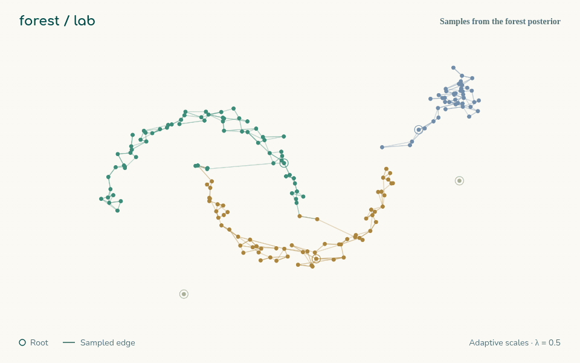

# The model and the math

With a common leaf scale $\sigma$, each tree factor $\prod_{(i,j) \in T_k} f(y_i \mid y_j)$ of this
model is the tree law of [the temperature dial](temperature.md) at $\lambda = 1/(2\sigma^2)$;
the forest adds roots, and so allows several trees.

This page separates what the cited papers establish from what this package implements
and derives. Statements about the papers are paraphrased; consult them for exact
assumptions. Every identity used by the code is checked against brute-force
enumeration on the [verification page](verification.md). These are existing models and
standard matrix-tree identities; this package does not claim a new statistical theory.

## The Bayesian spanning forest model (Duan & Roy, 2024)

Data $y_1, \dots, y_n \in \mathbb{R}^p$ are generated along a spanning forest. Each
cluster $V_k$ is a tree $T_k$ with a root $\rho_k$:

$$
L(y \mid V, F, R) = \prod_{k=1}^{K} r(y_{\rho_k}) \prod_{(i,j) \in T_k} f(y_i \mid y_j),
$$

with a diffuse root density $r$ (multivariate Cauchy in the paper) and a symmetric leaf
density $f$ (Gaussian, with local scales $\sigma_{ij} = \tilde\sigma_i \tilde\sigma_j$).
The edges and roots are latent; the partition $V$ is the parameter of interest.

Adding an auxiliary node $0$ joined to every root turns a rooted forest into one
spanning tree $\mathcal T$ on $n+1$ nodes. With the paper's prior
$\Pi(\mathcal T) \propto \lambda^K$, the posterior is a weighted spanning-tree
distribution:

$$
\Pi(\mathcal T \mid y) \propto \prod_{(i,j) \in \mathcal T} A_{ij},
\qquad A_{ij} = f(y_i \mid y_j), \quad A_{0i} = \lambda\, r(y_i).
$$

Summing over trees with Kirchhoff's matrix-tree theorem gives the marginal posterior
of the partition:

$$
\Pi(V \mid y) \propto \lambda^K \prod_{k=1}^{K}
\Big(\sum_{i \in V_k} r(y_i)\Big)\, \tau(V_k),
\qquad
\tau(V_k) = \sum_{T \text{ spans } V_k} \prod_{(i,j) \in T} A_{ij} = \det L_{V_k}^{(u)},
$$

where $L_{V_k}^{(u)}$ is the Laplacian of $A$ restricted to $V_k$ with any one row and
column removed.

**Results in the papers.**

- *Duan & Roy (2024), Theorem 1.* The leading eigenvectors of the posterior edge-inclusion
  matrix $M_{ij} = \Pr[(i,j) \in \mathcal T \mid y]$ are close to those used by normalized
  spectral clustering, with an explicit perturbation bound. This is the sense in which
  the forest model is a generative counterpart of spectral clustering.
- *Duan & Roy (2024), Theorems 2 and 3.* Posterior ratio consistency for separable
  clusters, under a diminishing kernel scale, a minimum-separation condition and a
  near-flat root density.
- *Zheng, Duan & Roy (arXiv:2409.19129, submitted).* Posterior concentration on the true
  partition when data come from an unknown collection of component distributions under
  a mild asymptotic separation condition, with an upper bound on the expected
  misclassification rate.

## Two closed forms

Write $L_g$ for the Laplacian of the augmented graph with node $0$ removed,
$L_g = \operatorname{diag}\big(\sum_j A_{ij} + A_{0i}\big) - A$, and $G = L_g^{-1}$.
The normalising constant of the tree law is $Z = \det L_g$ (matrix-tree theorem). Since
$\partial L_g / \partial A_{ij} = (e_i - e_j)(e_i - e_j)^\top$ and
$\partial L_g / \partial A_{0i} = e_i e_i^\top$,

$$
\Pr[(i,j) \in \mathcal T \mid y] = A_{ij}\,\frac{\partial \log Z}{\partial A_{ij}}
= A_{ij}\,(G_{ii} + G_{jj} - 2G_{ij}),
\qquad
\Pr[i \text{ is a root} \mid y] = A_{0i}\, G_{ii}.
$$

The first is Kirchhoff's rule: an edge's inclusion probability is its weight times its
effective resistance. Summing the second over $i$ gives the posterior mean number of
clusters, $\mathbb E[K \mid y] = \sum_i A_{0i} G_{ii}$, from one Cholesky factorisation.
This is the matrix $M$ that appears in Duan & Roy's Theorem 1, where it is derived from
the eigenvalues of the Laplacian.

## Rooted graph laws, counts, and attribution

The same implementation accepts an arbitrary symmetric nonnegative leaf graph, with
positive root weights $a_i$. Write $L$ for the leaf graph Laplacian and
$Q=\operatorname{diag}(a_1,\ldots,a_n)$. The rooted forest law is

$$
\Pr(F,R)=\frac{\prod_{e\in F}w_e\prod_{r\in R}a_r}{\det(L+Q)},
\qquad G=(L+Q)^{-1}.
$$

There is exactly one selected root per component. Positive root weights make $L+Q$
positive definite even if the leaf graph is disconnected. If every $a_i=q$, summing
over root choices contributes $q^K\prod_{C\in F}|C|$ for an unrooted edge set. This is
different from the unrooted fugacity law $q^K\prod_{e\in F}w_e$. In the Duan–Roy
observation model, $a_i=\lambda r(y_i)$ is generally not constant.

The standard matrix-forest identity gives **root attribution**:

$$
H_{ij}=\Pr(\text{the tree containing }i\text{ is rooted at }j)=G_{ij}a_j,
\qquad H\mathbf 1=\mathbf 1.
$$

`ForestKernel.root_assignment()` returns $H$. Its diagonal is the root-probability
vector. It is not the co-clustering matrix: two nodes can share a tree rooted at a third
node, so $H_{ij}$ is a different event from sharing a component. Co-clustering is
estimated from complete forest partitions.

Because every root carries one factor of $z$, the root-count probability generating
function is

$$
\mathbb E[z^K]=\frac{\det(L+zQ)}{\det(L+Q)}.
$$

Equivalently, if $\nu_1,\ldots,\nu_n$ are the eigenvalues of
$Q^{1/2}GQ^{1/2}$, then $K$ has the distribution of a sum of independent Bernoulli
variables with probabilities $\nu_i$. This is a distributional representation of the
count, not independence of the root indicators. `root_count_distribution()` convolves
these factors to return $\Pr(K=k)$ for $k=0,\ldots,n$; the count is at least one.
For a common multiplier $a_i=\lambda b_i$ with fixed $b_i$,
$\partial\mathbb E[K]/\partial\log\lambda=\operatorname{Var}(K)$.

These are existing matrix-forest / determinantal identities, not new results of this
package. The implementation is checked against finite enumeration. They apply to a
fixed unconstrained kernel. In adaptive mode, evaluating them at posterior mean scales
does not integrate over scale uncertainty, and rejection constraints change the target.

**Readout versus conditioning.** `BayesianSpanningForest(n_clusters=k)` fixes only the
number of groups in the final spectral + k-means decision. It leaves the sampled law
above unchanged. Exact conditioning on $K=k$ is not implemented by that argument.

## Exact sampling of spanning trees

Wilson's algorithm (1996) draws a spanning tree with probability proportional to the
product of its edge weights, exactly, by running loop-erased random walks. Rooting the
walks at the auxiliary node $0$ therefore yields exact draws from
$\Pi(\mathcal T \mid y)$ for fixed kernel parameters: the draws are independent, with
no burn-in. Duan & Roy use the Aldous–Broder covering walk, which targets the same law;
Tam, Dunson & Duan (2025) develop a fast-forwarded cover algorithm for graphs with
bottlenecks. This package implements Wilson's algorithm.

## The Gibbs sampler for adaptive scales

The paper places a hierarchical prior on the leaf scales and a prior on the Cauchy root
scale $\gamma$ (Section 2.4):

$$
\tilde\sigma_i \overset{iid}{\sim} \text{Inv-Gamma}(b_\sigma, \beta_\sigma),\quad
\beta_\sigma \sim \text{Exp}(\text{scale } \eta_\sigma),\quad
\eta_\sigma \sim \text{Inv-Gamma}(a_\sigma, \xi_\sigma),\quad
\gamma^2 \sim \text{Inv-Gamma}(2, 1),
$$

with $a_\sigma = 100$, $\xi_\sigma = 1$, $b_\sigma = 10$ and $\lambda = 0.5$. One sweep
(Section 3.1) draws the forest exactly given the scales, then each scale from its
conjugate conditional. For a node $i$ with tree neighbours $j$,

$$
\tilde\sigma_i \mid \cdot \sim \text{Inv-Gamma}\Big(b_\sigma + \tfrac{p}{2}\deg_{\mathcal T}(i),\;
\beta_\sigma + \sum_{j \sim i} \frac{\lVert y_i - y_j \rVert^2}{2\tilde\sigma_j}\Big).
$$

Each $\tilde\sigma_i$ depends only on its neighbours' scales, and a forest is bipartite
(colour nodes by depth parity), so this package updates all even-depth scales, then all
odd-depth scales, as two exact blocks. The root scale uses the scale-mixture form of the
Cauchy density with $u_i \sim \text{Inv-Gamma}(1/2, 1/2)$ for each root.

## What this package implements

| | Duan & Roy (2024) | `bgforest` |
|---|---|---|
| Model and hyper-priors | as above | the same, with the same constants |
| Forest step | Aldous–Broder covering walk (exact) | Wilson's algorithm (exact, same law) |
| Root-scale update | rate $\hat\sigma_y^2 + \dots$ | rate $1 + \dots$ (features are standardised) |
| Fixed-kernel mode | not discussed | independent exact draws, closed-form $M$ and $\mathbb E[K]$ |
| Point estimate | mode of $K$, then a rank-$K$ symmetric non-negative factorisation of the co-clustering matrix | mode of $K$ (or a given $K$), then its top-$K$ eigenvectors and $k$-means |
| Must-link / cannot-link | not in the paper | exact conditioning by rejection (an extension) |
| Latent-forest, covariate and multi-view extensions | Sections 2.5, 6 | not implemented |

## Practical notes

- **Use adaptive scales to infer $K$.** With fixed self-tuning scales the posterior puts
  most of its mass on few clusters; the paper's adaptive scales recover the number of
  clusters on the benchmark shapes. Fixed scales remain useful for exact, independent
  draws and closed forms.
- **Isolated points become their own trees.** They count towards $K$, so the posterior
  over $K$ is often wider than the number of large clusters.
- **Cost.** The kernel is dense ($n \times n$) and each sweep is one Wilson draw. Walks
  are slow when root weights are tiny relative to leaf weights, which is the bottleneck
  that Tam, Dunson & Duan's fast-forwarded sampler targets.

## References

- P. Chebotarev and E. Shamis. The matrix-forest theorem and measuring relations in
  small social groups. *Automation and Remote Control* 58(9):1505–1514, 1997.
  [Preprint](https://arxiv.org/abs/math/0602070).
- L. Avena and A. Gaudillière. Random spanning forests, Markov matrix spectra and
  well distributed points. [arXiv:1310.1723](https://arxiv.org/abs/1310.1723).

- L. L. Duan and A. Roy. Spectral clustering, Bayesian spanning forest, and forest
  process. *Journal of the American Statistical Association*, 119(547):2140–2153, 2024.
  [arXiv:2202.00493](https://arxiv.org/abs/2202.00493)
- Y. Zheng, L. L. Duan and A. Roy. Consistency of graphical model-based clustering:
  robust clustering using Bayesian spanning forest. Preprint,
  [arXiv:2409.19129](https://arxiv.org/abs/2409.19129)
- L. L. Duan and D. B. Dunson. Bayesian spanning tree: estimating the backbone of the
  dependence graph. *Journal of Machine Learning Research*, 24(397):1–44, 2023.
  [arXiv:2106.16120](https://arxiv.org/abs/2106.16120)
- L. L. Duan and D. B. Dunson. Bayesian distance clustering. *Journal of Machine
  Learning Research*, 22(224):1–27, 2021.
  [jmlr.org/papers/v22/20-688](https://jmlr.org/papers/v22/20-688.html)
- E. Tam, D. B. Dunson and L. L. Duan. Exact sampling of spanning trees via
  fast-forwarded random walks. *Biometrika*, 112(2):asaf031, 2025.
  [arXiv:2405.03096](https://arxiv.org/abs/2405.03096)
- D. B. Wilson. Generating random spanning trees more quickly than the cover time.
  *Proceedings of STOC*, 1996.
